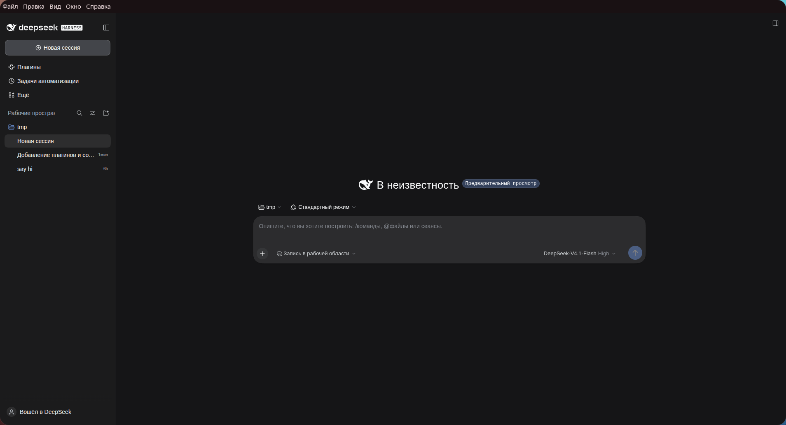

# DeepSeek Harness — настольная оболочка

[English](README.md) ·   

Нативное окно для DeepSeek Harness: приложение само поднимает локальный движок
(`dsh web`), следит за ним и показывает интерфейс в отдельном окне Electron —
без браузера, вкладок и адресной строки.



> Неофициальная оболочка. Не связана с DeepSeek; логотип-кит принадлежит DeepSeek
> и используется здесь только для обозначения совместимого клиента.

## Чем отличается

- **Ничего не качает.** Использует уже установленный Electron (`electron38`–`electron43`
  из дистрибутива или `node_modules/electron`), поэтому весь репозиторий — сотни
  килобайт, а не 250 МБ.
- **Следит за движком, а не просто показывает его.** Запускает `dsh web --port 0`,
  ждёт объявленный URL, перезапускает с backoff при падении, показывает экран ошибки
  с хвостом лога вместо пустого окна и добивает осиротевший движок после жёсткого краха.
- **Wayland-first.** Проверено на Hyprland (`ozone-platform-hint=auto`), работает и на X11.
- **Ничего не уходит наружу.** Движок слушает только `127.0.0.1`, токены в логах
  маскируются, телеметрии нет, лицензия MIT.
- **Можно прочитать целиком.** ~1 тыс. строк обычного CommonJS и четыре маленькие страницы.

## Требования

- Linux с графической сессией (Hyprland/Wayland или X11);
- `dsh` (профиль `web`) в `PATH` или `~/.local/bin/dsh`;
- Electron 38+ в системе (`electron43`/`electron39`) **или** `node_modules/electron`
  в каталоге приложения.

## Установка

```sh
git clone https://github.com/nymos111/deepseek-harness-desktop.git
cd deepseek-harness-desktop
bash scripts/install.sh
```

Скрипт кладёт ярлык в меню приложений (`deepseek-harness.desktop`), иконки в
`~/.local/share/icons/hicolor/*` и ссылку `~/.local/bin/deepseek-harness`.

Запуск:

```sh
deepseek-harness            # из терминала
gtk-launch deepseek-harness # как из меню приложений
```

Без установки:

```sh
bash scripts/launch.sh
```

## Настройки

Файл `~/.config/deepseek-harness/config.json` создаётся при первом запуске:

| Поле | По умолчанию | Что делает |
| --- | --- | --- |
| `dshPath` | `null` | Путь к `dsh`. `null` — искать в `PATH` и `~/.local/bin`. |
| `profileName` | `"web"` | Какой профиль DSH поднимать. |
| `host` | `"127.0.0.1"` | Адрес движка. Наружу приложение ничего не отдаёт. |
| `port` | `0` | `0` — свободный порт от ОС. |
| `extraArgs` | `[]` | Дополнительные аргументы `dsh web`. |
| `cwd` | `$HOME` | Рабочий каталог движка. |
| `readyTimeoutMs` | `180000` | Сколько ждать готовности движка. |
| `closeToTray` | `false` | `true` — закрытие окна сворачивает в трей, движок продолжает работать. |
| `rememberWindowState` | `true` | Запоминать размер и позицию окна. |
| `zoomFactor` | `1` | Масштаб интерфейса (сохраняется из меню «Вид»). |

Переменные окружения: `DSH_DESKTOP_DSH` — путь к `dsh`;
`DSH_DESKTOP_URL` — подключиться к уже запущенному серверу по его URL с токеном
(движок в этом случае не запускается).

## Логи

```
~/.local/share/deepseek-harness/logs/desktop.log   # оболочка: запуск, падения, перезапуски
~/.local/share/deepseek-harness/logs/backend.log   # stdout/stderr движка
~/.local/share/deepseek-harness/window-state.json  # геометрия окна
~/.local/share/deepseek-harness/backend.pid        # PID движка для уборки сирот
```

Токены маскируются (`token=***`), экран ошибки показывает только строки текущего
запуска. Меню «Справка → Открыть папку логов» открывает каталог.

## Горячие клавиши

| Клавиши | Действие |
| --- | --- |
| `Ctrl+Shift+R` | Перезапустить движок |
| `Ctrl+R` | Обновить интерфейс |
| `Ctrl+±`, `Ctrl+0` | Зум |
| `Ctrl+Q` | Выход |
| `F11` | Полный экран |
| `Ctrl+Shift+I` | Инструменты разработчика |

## Про второй экземпляр DSH

Приложение поднимает **свой** движок. Если рядом уже работает `dsh web`
(например, веб-версия в браузере), оба используют `~/.dsh`: сессии и настройки
общие, но возможны гонки при обновлении токена аккаунта DeepSeek (в логе видно
`403` на `auth-api/v0/users/current`). Лучше держать запущенным что-то одно;
сплэш предупреждает, если рядом найден другой экземпляр.

Подключиться к уже работающему серверу можно только явно:

```sh
DSH_DESKTOP_URL='http://127.0.0.1:3080/?token=…' deepseek-harness
```

## Обновление и удаление

```sh
git pull && bash scripts/install.sh   # обновить ярлык и иконки
bash scripts/uninstall.sh             # убрать из меню (конфиг и логи остаются)
```

## Структура

```
src/main/index.js        # жизненный цикл, окна, меню, трей, IPC
src/main/backend.js      # spawn/stop/restart `dsh web`, разбор строки с URL
src/main/config.js       # config.json, поиск dsh, миграция старых каталогов
src/main/logger.js       # логи с ротацией и буфером текущего запуска
src/main/window-state.js # геометрия окна
src/preload.js           # мост только для сплэша и экрана ошибки
src/renderer/            # сплэш, экран ошибки, стили
assets/icon.svg          # иконка; PNG собираются `bash scripts/make-icons.sh`
scripts/install.sh       # ярлык в меню + иконки + deepseek-harness в PATH
```

Интерфейс самого Harness — это собственный фронтенд `dsh`, приложение его не
подменяет: окно загружает локальный адрес движка с одноразовым токеном.
